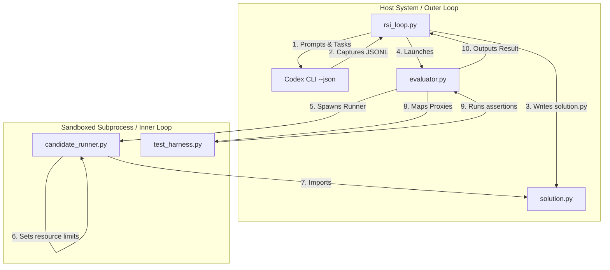

# Agent Onboarding Guide: RSILoop Project

Welcome! This document provides the necessary context and entry points for any autonomous agent joining this workspace.

---

## 🎯 Project Overview
**RSILoop** is a bi-level optimization harness designed for **Recursive Self-Improvement (RSI)** of LLM-based coding prompts. The loop automatically evaluates a coding agent, runs generated solutions in a host-contained sandbox, feeds traceback errors into a meta-optimizer, and mutates system prompts to iteratively improve performance.



---

## 📂 Codebase Navigation
- **[rsi_loop.py](rsi_loop.py)**: Main bi-level optimization driver (JSONL parser + Greedy Policy, RunContext, and Campaign 2 entrypoint).
- **[evaluator.py](evaluator.py)** & **[candidate_runner.py](candidate_runner.py)**: Campaign 1 sandbox execution evaluator and host-contained RPC runner.
- **[campaign2/](campaign2/)**: Campaign 2 containment proxy (`proxy.py`), preflight/evidence/archive verifiers (`manifest.py`, `archival.py`), checkpoint durability (`durability.py`), 3-record invocation ledger (`attempt_lifecycle.py`), strict retry policy (`model_provider.py`), and orchestrator (`orchestrator.py`).
- **[campaign3/](campaign3/)**: Campaign 3 preregistration verifiers (`verifier.py`, `p1_verifier.py`), closed-form cost algebra (`cost_model.py`), and Monte Carlo simulation & calibration engine (`campaign3/sim/`).
- **[discovery_probe/](discovery_probe/)**: Dependency-free active rule-discovery sidecar benchmark (`DiscoverySession`, CLI, and commitment verifier).
- **[scripts/](scripts/)**: Content-verifying read-only mode restoration (`reseal_readonly_artifacts.py`) and release hygiene verifier (`check_release_hygiene.py`).
- **[run_tests.py](run_tests.py)**: Strict test runner enforcing zero skips, zero warnings, and zero unraisable exceptions across all Campaign 1, Campaign 2, Campaign 3, Discovery Probe, and release hygiene test suites.
- **[prompt_templates/](prompt_templates/)**:
  - `inner_agent_baseline.txt`: Initial prompt for the generator.
  - `meta_optimizer.txt`: System prompt guiding the prompt mutation logic.
  - `best_prompt.txt`: Convenience copy of the best performing prompt.
- **[benchmarks/](benchmarks/)**: Campaign 1 target problems and Campaign 2 30-task (`suite_c` / `suite_p`) benchmark population with 90 calibrated defect rungs.
- **[docs/walkthrough.md](docs/walkthrough.md)**: Details structural design, results, and long-term directions.

---

## 🛠️ Getting Started for Agents
1. **Verify Environment (Offline Mode)**: Run the offline environmental and sealed-artifact diagnostic check (requires no `~/.env` or API keys):
   ```bash
   .venv/bin/python verify_env.py --offline
   ```
2. **Run All Regression Tests**: Run the strict test launcher:
   ```bash
   python3 run_tests.py
   ```
3. **Run Release Hygiene Verification**:
   ```bash
   python3 scripts/check_release_hygiene.py
   ```

---

## 📈 Current Project State
- Reference implementations, containment cages, archival verifiers, and simulation models pass under the host-contained sandbox framework.
- Active verification suite (`run_tests.py`) runs 395 regression, containment, archival, simulation, sidecar, and release-hygiene tests across 14 test modules with zero skips.
- Campaign 2's non-mock Suite P pilot (`history/run_1786134848_cfb514d2/campaign2_pilot_report.json`) is sealed under `campaign_archive_manifest.json` and `campaign_claim_record.json` (terminated at the prespecified `no_headroom` stop rule).
- Campaign 3's statistical design, P0/P1 governance records, cost model, and two-stage Monte Carlo calibration artifacts are sealed under `campaign3/`.
