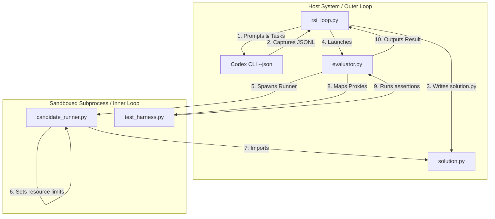

# Agent Onboarding Guide: RSILoop Project

Welcome! This document provides the necessary context and entry points for any autonomous agent joining this workspace.

---

## 🎯 Project Overview
**RSILoop** is a bi-level optimization harness designed for **Recursive Self-Improvement (RSI)** of LLM-based coding prompts. The loop automatically evaluates a coding agent, runs generated solutions in a host-contained sandbox, feeds traceback errors into a meta-optimizer, and mutates system prompts to iteratively improve performance.



---

## 📂 Codebase Navigation
- **[rsi_loop.py](rsi_loop.py)**: Main bi-level optimization driver (JSONL parser + Greedy Policy, RunContext).
- **[evaluator.py](evaluator.py)**: Sandbox execution evaluator with dynamic class/instance caching and unified clean exit.
- **[candidate_runner.py](candidate_runner.py)**: Host-contained runner enforcing irreversible resource limits and RPC envelope codec.
- **[test_evaluator.py](test_evaluator.py)**: Containment, IPC, and reference solution regression tests.
- **[test_rsi_loop.py](test_rsi_loop.py)**: Orchestrator, preflight verification, and E2E state tests.
- **[run_tests.py](run_tests.py)**: Strict test runner enforcing zero skips and zero ResourceWarnings.
- **[prompt_templates/](prompt_templates/)**:
  - `inner_agent_baseline.txt`: Initial prompt for the generator.
  - `meta_optimizer.txt`: System prompt guiding the prompt mutation logic.
  - `best_prompt.txt`: Convenience copy of the best performing prompt.
- **[benchmarks/](benchmarks/)**: target problems and verification files.
- **[docs/walkthrough.md](docs/walkthrough.md)**: Details structural design, results, and long-term directions.

---

## 🛠️ Getting Started for Agents
1. **Verify Environment**: Run the environmental diagnostic check.
   ```bash
   .venv/bin/python verify_env.py
   ```
2. **Run All Regression Tests**: Run the strict test launcher:
   ```bash
   python3 run_tests.py
   ```
3. **Run Optimization Loop**: Spin up the automated prompt-mutation iteration.
   ```bash
   python3 rsi_loop.py
   ```

---

## 📈 Current Project State
- Reference implementations and harness regressions pass under the host-contained sandbox framework.
- Active verification suite contains 47 regression and behavioral resource limit tests.
- No experiment has run under the current frozen protocol, but a legacy experiment artifact exists.
- The pipeline supports promotion to `best_manifest.json` once a real experiment run is executed under the approved protocol.
