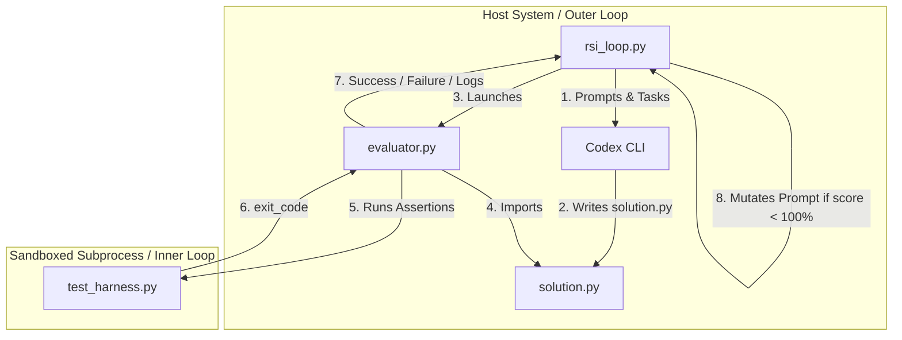

# Walkthrough: Sandbox-Safe RSI Loop with Codex

> "Talk is cheap. Show me the code." — Linus Torvalds

This walkthrough documents the design, execution, and output of the Recursive Self-Improvement (RSI) prompt optimization loop implemented in this repository.

---

## 1. System Architecture

The setup isolates the LLM generation environment from the evaluation environment to prevent execution risks while automating iterative prompt mutations.



---

## 2. Core Orchestration Code

The system's behavior is dictated by two scripts. Below are the core implementations that act as the source of truth.

### The Evaluator ([evaluator.py](evaluator.py))
To prevent infinite loops from hanging the parent process, execution is constrained by a strict timeout. `sys.path` is manipulated dynamically to isolate the benchmark tests:

```python
def evaluate_benchmark(benchmark_dir):
    test_harness_path = os.path.join(benchmark_dir, "test_harness.py")
    if not os.path.exists(test_harness_path):
        return {"success": False, "error": "test_harness.py not found"}
    
    solution_path = os.path.join(benchmark_dir, "solution.py")
    if not os.path.exists(solution_path):
        return {"success": False, "error": "solution.py not found"}
        
    try:
        # Run python -m unittest test_harness.py in the directory
        res = subprocess.run(
            [sys.executable, "-m", "unittest", "test_harness.py"],
            cwd=benchmark_dir,
            capture_output=True,
            text=True,
            timeout=3.0 # strict timeout to prevent infinite loops
        )
        passed = (res.returncode == 0)
        output = res.stdout + "\n" + res.stderr
        return {
            "success": passed,
            "error": None if passed else output.strip(),
            "code": res.returncode
        }
```

### The LLM Driver ([rsi_loop.py](rsi_loop.py))
To feed complex system prompts and task files directly to Codex without command-line argument length limitations or escaping errors, we pipe the text via `stdin` and read the agent response back from a redirected output file (`-o`):

```python
def call_codex(prompt: str, system_instruction: str = None) -> str:
    full_prompt = ""
    if system_instruction:
        full_prompt += f"System Instruction:\n{system_instruction}\n\nTask Instruction:\n"
    full_prompt += prompt
    
    output_file = os.path.join(BASE_DIR, "codex_output.txt")
    if os.path.exists(output_file):
        os.remove(output_file)
        
    cmd = [
        "codex", "exec", "-", 
        "--dangerously-bypass-approvals-and-sandbox",
        "-o", output_file
    ]
    
    try:
        res = subprocess.run(
            cmd,
            input=full_prompt,
            capture_output=True,
            text=True,
            timeout=120
        )
        if not os.path.exists(output_file):
            print(f"Codex error (no output file). Stderr:\n{res.stderr}\nStdout:\n{res.stdout}")
            return ""
        
        with open(output_file, "r") as f:
            content = f.read()
        os.remove(output_file)
        return content
```

---

## 3. Empirical Results & Generated Code

In the Codex-based execution, the baseline prompt immediately achieved **3/3 (100.0%)** on the benchmarks. Here is how it solved the two most structurally complex benchmarks:

### Circular Buffer ([benchmarks/circular_buffer/solution.py](benchmarks/circular_buffer/solution.py))
Instead of writing complex pointer arithmetic, the model leveraged `collections.deque` with `maxlen` to handle automatic overwriting of old items:

```python
from collections import deque

class BufferFullException(Exception):
    pass

class BufferEmptyException(Exception):
    pass

class CircularBuffer:
    def __init__(self, capacity: int):
        self.capacity = capacity
        self._buffer = deque(maxlen=capacity)

    def write(self, item):
        if len(self._buffer) == self.capacity:
            raise BufferFullException()
        self._buffer.append(item)

    def read(self):
        if not self._buffer:
            raise BufferEmptyException()
        return self._buffer.popleft()

    def overwrite(self, item):
        self._buffer.append(item)
```

### JSON Parser ([benchmarks/json_parser/solution.py](benchmarks/json_parser/solution.py))
The manual JSON parser was implemented as a recursive-descent parser class contained inside a closure to prevent symbol leaking, handling decimal strings, escapes, and surrogate pairs manually:

```python
def parse_json(s: str) -> Any:
    class Parser:
        # ... Parser fields & state variables ...
        def parse_unicode_escape(self) -> str:
            code = self.read_hex_codepoint()
            # Handle high/low surrogates
            if 0xD800 <= code <= 0xDBFF:
                if not self.text.startswith("\\u", self.pos):
                    self.error("Missing low surrogate")
                self.pos += 2
                low = self.read_hex_codepoint()
                if not 0xDC00 <= low <= 0xDFFF:
                    self.error("Invalid low surrogate")
                code = 0x10000 + ((code - 0xD800) << 10) + (low - 0xDC00)
            elif 0xDC00 <= code <= 0xDFFF:
                self.error("Unexpected low surrogate")
            return chr(code)
        
        # ... Number parser enforcing trailing/leading float logic ...
```

---

## 4. Conservative Roadmap

To scale this to a true self-improving agent platform, we must address existing limitations without overclaiming capabilities.

### Identified Limits:
1. **Low Benchmark Diversity**: 3 benchmarks are not representative. An agent could easily overfit a prompt to pass these three while breaking general capabilities.
2. **Greedy Trajectory Selection**: Currently, the outer loop accepts a mutated prompt only if the score is strictly higher. It does not allow for exploration of prompts that might yield long-term benefits despite minor short-term drops.

### Recommended Next Steps:

1. **Adversarial Benchmark Ingestion**
   * Expand the suite to at least 15 heterogeneous tasks including: AST transformation, state-machine generators, and basic cryptographical routines.
   * Write an automated script that extracts tasks from public datasets (like HumanEval) and structures them into the `/benchmarks` directory.

2. **Cost-Agnostic vs. Cost-Aware Search**
   * Track token usage of the inner loops programmatically.
   * Mutate the fitness function from `score` to `score - alpha * (tokens_used / 1000)`. This forces the optimizer to actively seek smaller, tighter prompts (context compression).

3. **Rollout Policies (Lineage Branching)**
   * Avoid simple overwrite of prompts. Implement a prompt mutation tree.
   * Spawn 3 parallel prompt variations per iteration, evaluate them in parallel branches, and choose the most promising path (similar to the tree-search policies discovered in AIDE²).
