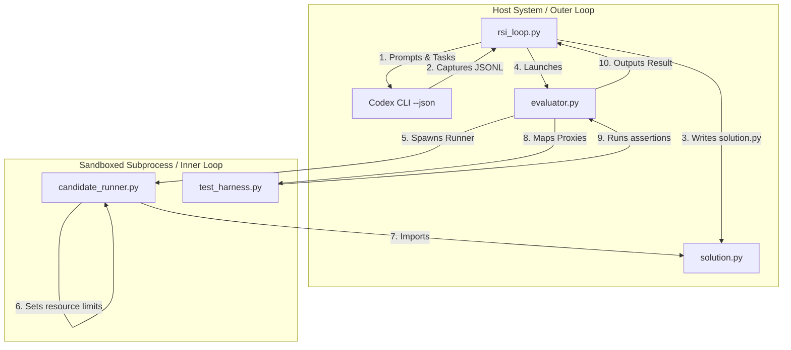

# Walkthrough: Sandbox-Safe RSI Loop with Codex

This document provides a comprehensive, code-centric guide explaining the design, containment architecture, exception fidelity system, structured event parsing, and verification metrics for the **Recursive Self-Improvement (RSI)** prompt optimization loop.

---

## 1. Host-Containment Architecture

The framework isolates LLM code generation (Outer Loop) from execution/evaluation (Inner Loop) using macOS `sandbox-exec` profiles.



### Sandbox SBPL Profiles

#### Candidate Profile (`candidate.sb.template`)
Denies all filesystem writes (except to the designated `{temp_dir}`) and process forks. Allowlists only necessary system libraries, python virtualenv paths, and candidate source files:
- Allows `process-exec` only for virtualenv, Python interpreter, system base prefixes, and resolved Homebrew paths.
- Denies `process-fork` globally to prevent candidate code spawning child processes.
- Read allowlist restricted to `/System`, `/usr`, `/Library`, virtualenv paths, system prefixes, and candidate/temp working directories.

#### Generator Profile (`generator.sb.template`)
Restricts Codex file access to prevent private task holdout or credentials leakage:
- Read access denied to the codebase repository (except for the active candidate generation directory).
- Write access permitted only to Codex temp home and active candidate directory.

---

## 2. Dynamic Evaluator & Cache Caching Proxy

To verify candidate solutions containing class definitions and exceptions without running test code inside the host process:
1. **Dynamic Proxies**: The host queries the runner's exports (`get_exports`). For ordinary classes, it instantiates dynamic proxies (`DynamicClassProxy`) capturing their names via a factory function.
2. **Double-Pass Exports Decoding**: Exports processing registers class metadata first, maps functions and classes next, and then decodes variable envelopes containing object references.
3. **Class & Instance Caching**:
   - `class_proxy_cache` prevents proxy class duplication per session, ensuring correct `isinstance` checks.
   - `proxy_instance_cache` guarantees that returning the same object reference preserves identity (`returned_obj1 is returned_obj2`).
4. **Exception MRO Replication**: For custom exceptions, the runner gathers their Method Resolution Order (`__mro__`). The host dynamically reconstructs an identical class inheritance hierarchy (`type(name, tuple(bases), {})`) in a local registry, preserving qualified types and MRO identity.
5. **Irreversible Sandbox & Resource Limits**: The runner applies `setrlimit` (RLIMIT_CPU, RLIMIT_FSIZE, RLIMIT_NOFILE, RLIMIT_CORE) and reports `ready` to the host *after* limit initialization succeeded, validating that candidate code starts fully restricted.
6. **Subprocess Reaping**: Terminated runner processes are reaped explicitly using SIGKILL, and wait for process exit to eliminate resource leaks.

---

## 3. Structured Event Stream Parsing & Greedy Search Policy

### JSONL Parser
Codex is called with `--json` to output structured JSONL streams. The orchestrator:
- Accepts text only when `type == "item.completed"` and `item.type == "agent_message"`.
- Requires exactly one valid `turn.completed` usage event.
- Extracts token counts from the structured `usage` metadata (`output_tokens` applied against the authoritatively enforced 50,000 token budget).
- Fails closed immediately on missing or malformed events.

### Greedy Policy
- Evolve mutations strictly using failure evidence generated by the *best accepted prompt*.
- On score regression, mutations are discarded, search reverts to the best prompt, and previous failures are provided as negative search history to avoid repeating failed paths.

---

## 4. Verification & Holdout Generalization

### Automated Strict Test Launcher
Run the regression tests using the strict combined test launcher:
```bash
python3 run_tests.py
```
This launcher:
- Promotes `ResourceWarning` to errors.
- Installs unraisable exception hooks to capture background thread/cleanup failures.
- Forces garbage collection (`gc.collect()`).
- Fails strictly on any skipped tests.
- Validates that a minimum of 34 tests are executed (verifies 41+ tests).

### Path Containment Integrity
- All directories and files created during the run are strictly contained within `history/` verified using `os.path.commonpath`.
- Path traversal attempts, symlinks, or parent-directory symlinks fail the run closed.

### Unseen Holdout Task
The final promoted best prompt is validated against the unseen `simple_regex_matcher` holdout task:
- Codex is run in a separate directory containing only the copied `problem.txt`.
- The candidate code is executed securely against the host-side `test_holdout.py` (which is kept out of the worker's sandbox).
- Results, solution hashes, and harness hashes are written to the sealed `best_manifest.json` validation log.
- **Note**: Statistical significance is not established by the validation gate sampling.
